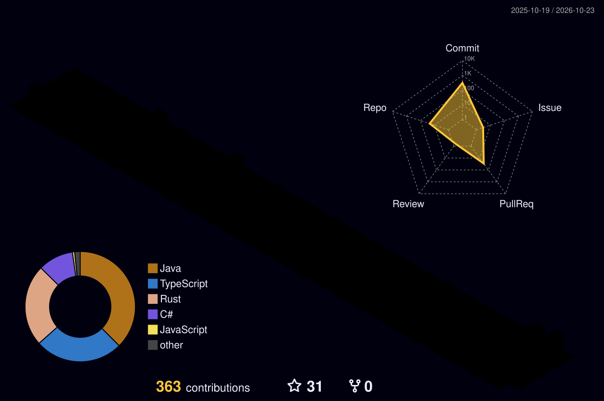

## 👋 Hello, nice to meet you! I'm Thiago

I'm a backend developer who enjoys building systems that are simple to understand, easy to maintain and ready to grow. I believe in clean code, good practices and continuous learning.

- 💼 Focused on **backend** development
- 🌱 Always studying new technologies and going deeper into the ones I already use
- 🤝 Open to chat, exchange ideas and new opportunities

## 🛠 Tech Stack

I list only what I actually use, grouped by how familiar I am with each one.

### 🟢 Daily use
<!-- TODO(Thiago): confirm/adjust this list -->

### 🟡 Currently learning
<!-- TODO(Thiago): confirm/adjust this list -->

### ⚪ Some exposure
<!-- TODO(Thiago): confirm/adjust this list -->

## 📊 My contributions in 3D

## 🚀 Featured projects

<!-- TODO(Thiago): pick 2-4 repositories and fill in -->
| Project | Description | Technologies |
| ------- | --------- | ----------- |
| [Project name](https://github.com/ThiagoNascBarros/REPO-NAME) | One line explaining what it does | C#, .NET |

## 📫 Let's talk!

